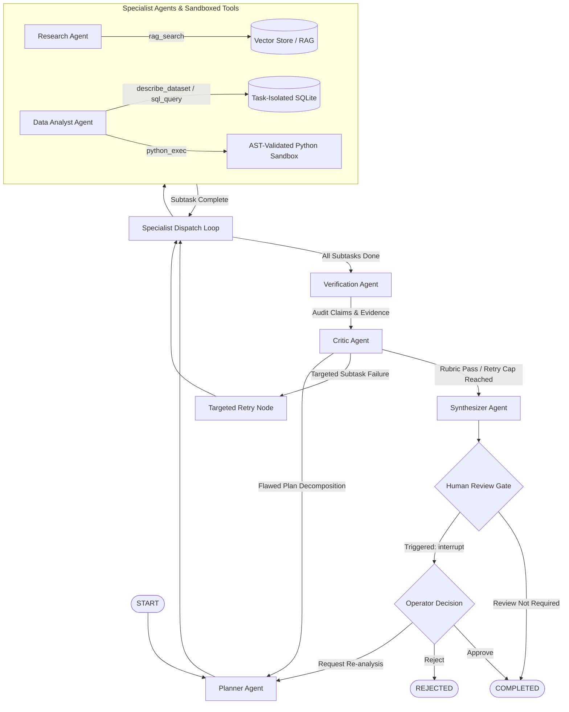

# Aegis — Autonomous Multi-Agent AI Engineering & Research Orchestrator

> **Status:** Phase 1; not deployed; sandbox not a security boundary; no benchmark yet.

Aegis is an autonomous, stateful multi-agent AI system built on LangGraph, FastAPI, and Pydantic v2. It coordinates specialized agents to analyze complex engineering questions, query technical literature, inspect empirical datasets, audit claims for factual consistency, and produce verified synthesis reports.

Every number and metric in Aegis is either mathematically computed, extracted from cited evidence, or explicitly null — zero hard-coded domain findings, canned statistics, or scripted confidence constants.

---

## 1. System Architecture

Aegis implements a cyclic, stateful state graph managed by LangGraph. Task progress is tracked via real-time telemetry events and persisted checkpoints.



---

## 2. Core Agents & Responsibilities

Aegis divides engineering analysis across six specialized agents:

1. **Planner Agent (`PlannerAgent`)**: Decomposes natural-language user queries into an acyclic dependency graph of atomic subtasks (up to 6 subtasks) assigned to authorized agents. Validates plan constraints and automatically attempts a single schema-guided repair before rejecting malformed plans.
2. **Research Agent (`ResearchAgent`)**: Queries indexed technical standards, manuals, and papers using semantic retrieval (`rag_search`). Returns empirical findings citing specific verified chunk IDs.
3. **Data Analyst Agent (`DataAnalystAgent`)**: Ingests tabular datasets into task-isolated SQLite databases and parquet workspaces. Queries data via sanitized SQL (`sql_query`), schema inspection (`describe_dataset`), and AST-sandboxed Python analysis (`python_exec`).
4. **Verification Agent (`VerificationAgent`)**: Independently audits all claims generated by specialist agents. Runs deterministic numerical verification (1% relative tolerance) and queries an LLM Judge with strict verbatim quote-span validation. Claims lacking verbatim textual evidence are automatically downgraded.
5. **Critic Agent (`CriticAgent`)**: Performs rubric scoring (0–10) across four criteria: *answers_question*, *uses_task_data*, *claims_verified*, and *limitations_stated*. Governs targeted subtask retries and plan re-decomposition. Quality pass is computed deterministically in code.
6. **Synthesizer Agent (`SynthesizerAgent`)**: Compiles only empirically verified findings into an executive report. Excluded or unverified claims are transparently relegated to the report's limitations section.

---

## 3. Tool Sandboxing & Permission Matrix

Aegis enforces role-based tool authorization and execution boundaries:

| Agent Role | Permitted Tools | Sandbox & Security Constraints |
| :--- | :--- | :--- |
| **Planner** | *None* | Pure structured schema generation (`ExecutionPlan`). |
| **Research** | `rag_search` | Read-only vector store cosine similarity retrieval (HNSW indexed). |
| **Data Analyst** | `describe_dataset`, `sql_query`, `python_exec` | Read-only single-statement SQL (`SELECT`/`WITH` only; `DROP`/`ALTER` rejected). AST validator blocks dangerous builtins (`eval`, `exec`, `open`, `compile`) and restricted modules (`os`, `sys`, `subprocess`, `shutil`, `socket`). 20-second timeout. |
| **Verification** | *None (LLM Judge & Internal RAG)* | Evaluates claims against resolved source chunk text. |
| **Critic** | *None* | Pure structured rubric evaluation. |
| **Synthesizer** | *None* | Structured report compilation from verified findings only. |

> [!WARNING]
> The AST-based Python executor provides defense-in-depth against accidental operations; it is **not** an operating system security boundary. Do not run untrusted arbitrary code in shared environments.

---

## 4. Human-in-the-Loop Review Gate

The human review gate uses LangGraph's native `interrupt()` mechanism:
- **Trigger Conditions**: Explicit task configuration (`require_human_approval=True`), critic quality failure, detected contradictions, or verification supported ratio below 80%.
- **State Suspension**: Execution halts cleanly at the checkpoint, returning `status: "waiting_approval"` and a `HumanApprovalRequest` detailing the proposed recommendations and risk level.
- **Resumption**: Operators resume execution via `POST /api/tasks/{task_id}/approve` with `approve`, `reject`, or `request_reanalysis` (with optional feedback). Resuming with re-analysis routes back to the planner with user feedback and increments the retry counter. Attempting to approve tasks not in `WAITING_APPROVAL` status returns `409 Conflict`.

---

## 5. Telemetry & Cost Accounting

Every LLM interaction (`chat` and `structured`) records real token usage:
- **Trace Events (`TraceEvent`)**: Captures `input_tokens`, `output_tokens`, `token_usage`, `call_count`, `duration_ms`, `model`, and `cost_usd`.
- **Pricing Registry (`pricing.yaml`)**: Model token pricing is resolved from `pricing.yaml`. If a model has no pricing entry, `cost_usd` is reported as `None` (no fabricated costs).
- **Server-Sent Events (SSE)**: `GET /api/tasks/{task_id}/events` streams trace events in real time. Events are de-duplicated by `event_id` to guarantee replay order and prevent duplication upon client reconnection.

---

## 6. Setup & Configuration

### Prerequisites
- Python 3.12 (tested on Python 3.12.11)
- `uv` (recommended package manager) or `pip`

### Installation

```bash
# Clone repository
git clone https://github.com/Aditya-Pathanjali/aegis.git
cd aegis

# Create and activate virtual environment
python -m venv .venv
source .venv/bin/activate  # On Windows: .venv\Scripts\activate

# Install dependencies from lockfile
uv pip sync requirements.lock requirements-dev.lock
# Or using pip:
pip install -r requirements.lock -r requirements-dev.lock
```

### Configuration

Aegis uses `pydantic-settings` with the `AEGIS_` prefix. Configure your provider via environment variables or a `.env` file:

```bash
# Provider: 'anthropic' or 'openai'
export AEGIS_PROVIDER="anthropic"
export AEGIS_MODEL="claude-sonnet-5-5"
export ANTHROPIC_API_KEY="your-anthropic-api-key"

# Optional judge model override
export AEGIS_JUDGE_MODEL="claude-sonnet-5-5"

# For OpenAI:
# export AEGIS_PROVIDER="openai"
# export AEGIS_MODEL="gpt-4o"
# export OPENAI_API_KEY="your-openai-api-key"
```

---

## 7. Running Tests & Demo

### Running the Test Suite
All tests use deterministic fakes and verify input-dependent behavior without API costs:

```bash
# Run complete test suite (unit, fakes, property, and integration tests)
pytest -v

# Run linter
ruff check .
```

### Running Live Tests (Requires API Key)
```bash
export ANTHROPIC_API_KEY="sk-ant-..."
pytest -v -m live
```

### Running the Live Demonstration Script
```bash
python scripts/run_demo.py
```
This executes two live end-to-end queries (literature inquiry and C-MAPSS dataset analysis), streams execution telemetry to the terminal, and writes transcripts to `docs/phase1_demo.md`.

---

## 8. Dataset Citation

The sample dataset in `data/samples/fd001_train_5engines.csv` is derived from the NASA Commercial Modular Aero-Propulsion System Simulation (C-MAPSS) Turbofan Engine Degradation dataset:

> A. Saxena, K. Goebel, D. Simon, N. Eklund, *"Damage Propagation Modeling for Aircraft Engine Run-to-Failure Simulation"*, Prognostics and Health Management (PHM), 2008.

---

## 9. Current Status & Roadmap

- **Current Status**: Phase 1 completed. Real input-dependent agent workflows, AST-sandboxed tool loops, deterministic verification checks, LangGraph interrupt review gates, and SSE telemetry streaming.
- **Out of Scope (Phases 2–4)**:
  - Phase 2: Distributed task queues (Celery/Temporal) and persistent PostgreSQL checkpointer.
  - Phase 3: Benchmark evaluation suite across agent topologies.
  - Phase 4: Authentication, role-based multi-tenancy, and cloud container deployment.
